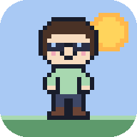
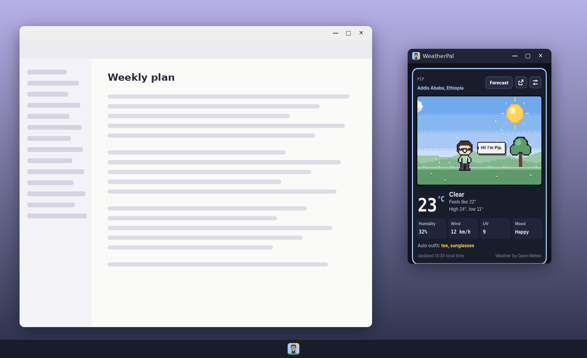
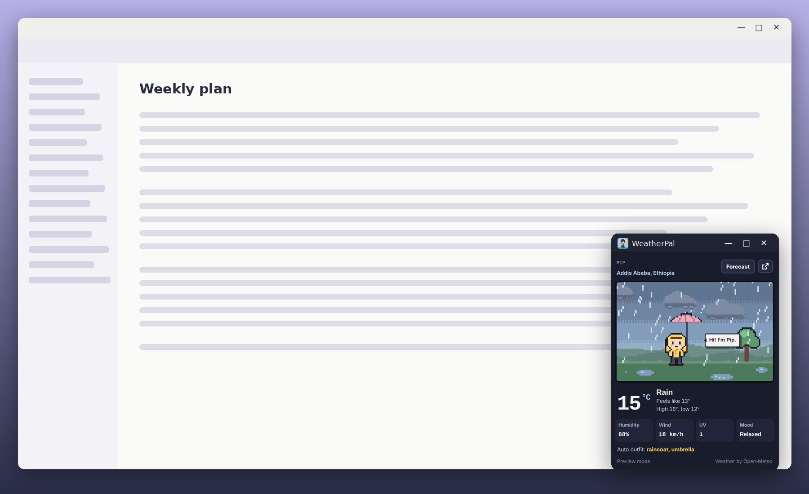
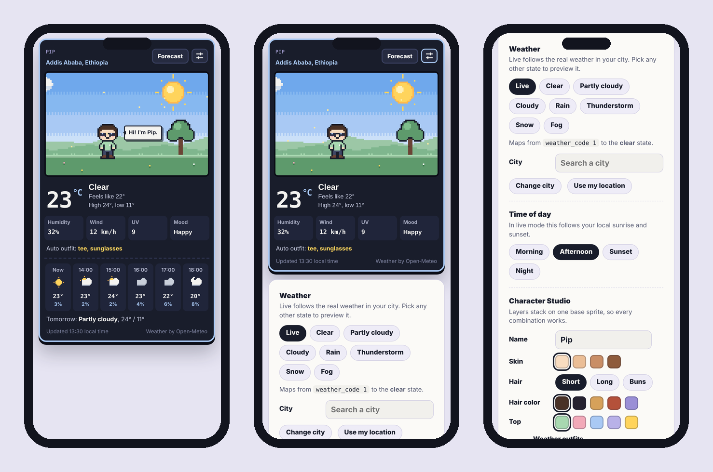
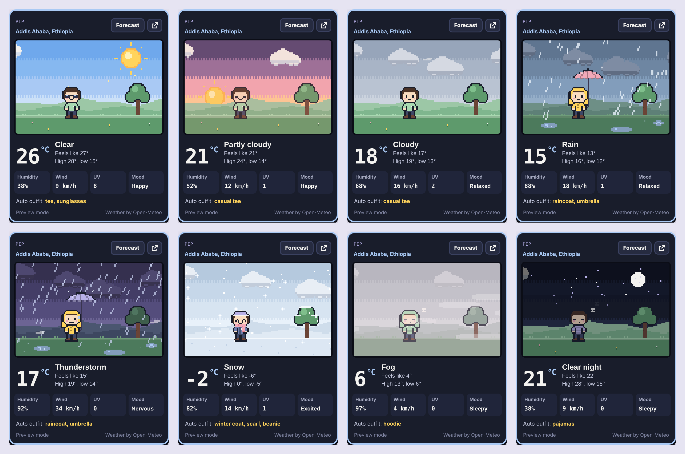
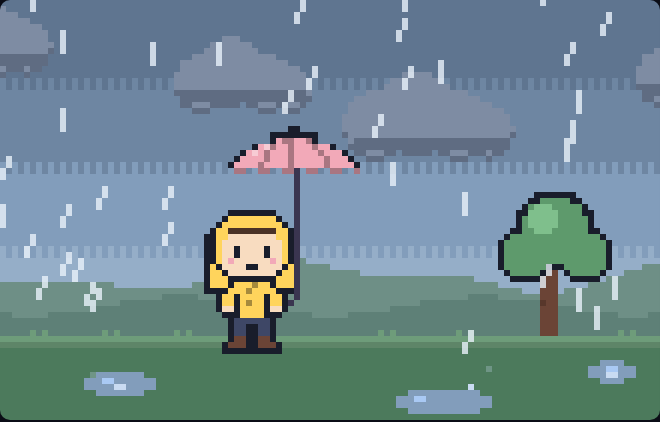
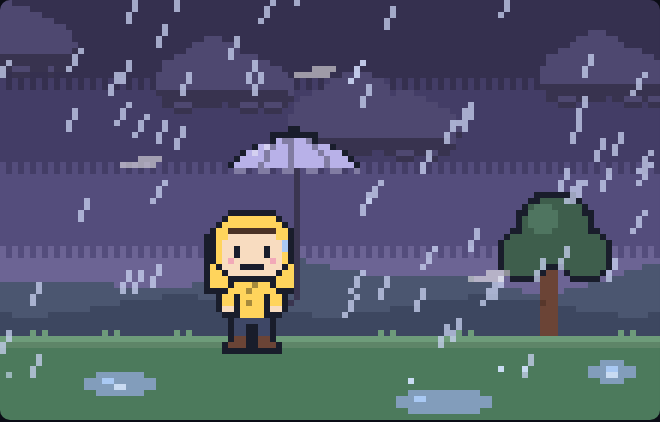
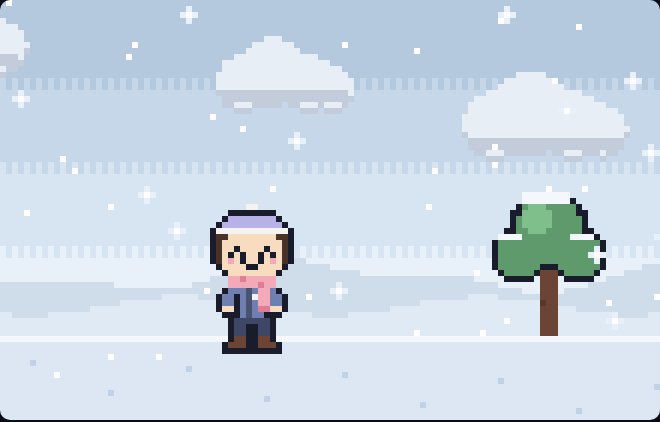
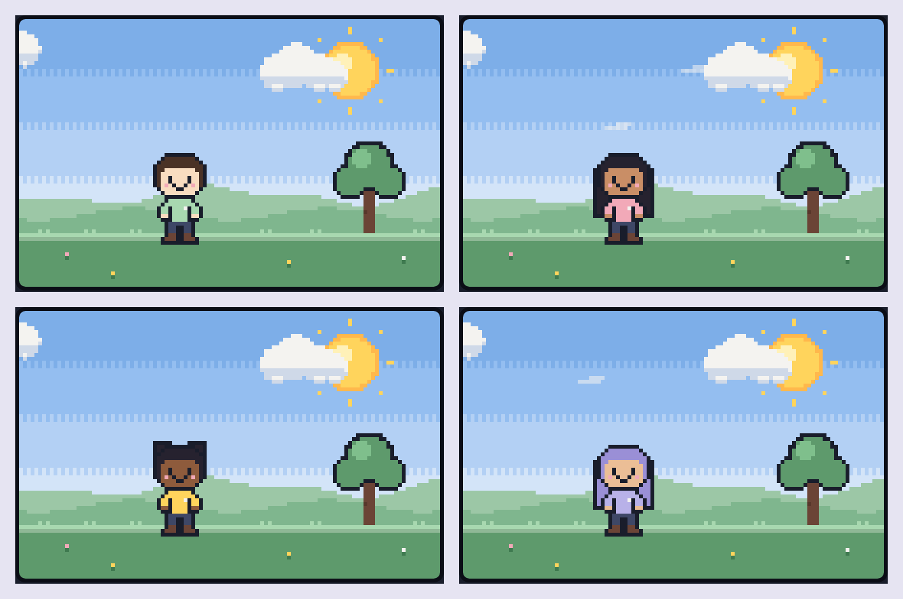
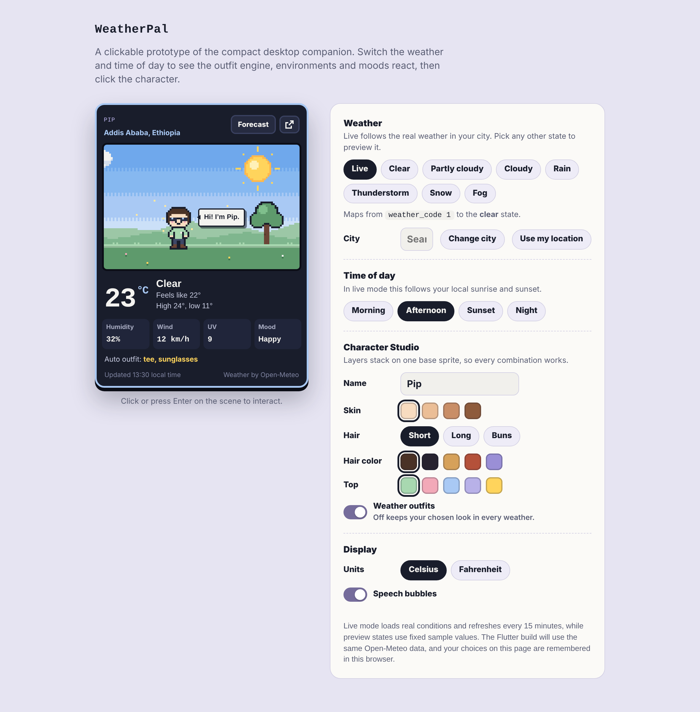

<p align="center">
  
</p>

<h1 align="center">WeatherPal</h1>

<p align="center">
  <b>A pixel-art weather buddy for your desktop and phone.</b><br>
  Install it like an app, keep it on the side of your screen, and glance at a tiny world that matches the weather outside.
</p>

<p align="center">
  
  
  
  
  
</p>

<p align="center">
  
</p>

---

> [!NOTE]
> This is the **installable web app** version of WeatherPal. It grew out of the [working prototype](https://github.com/YOUR-USERNAME/weatherpal-pixel-weather-companion) and adds installing on a PC or phone, a compact buddy mode, an always-on-top floating window, GPS location and offline use. The native Flutter app is the next step in the [specification](docs/SPECIFICATION.md).

## Contents

- [What it is](#what-it-is)
- [Screenshots](#screenshots)
- [Features](#features)
- [Install it](#install-it)
- [How it works](#how-it-works)
- [Design system](#design-system)
- [Project structure](#project-structure)
- [Roadmap](#roadmap)
- [Privacy and accessibility](#privacy-and-accessibility)
- [Contributing](#contributing)
- [License and credits](#license-and-credits)

## What it is

WeatherPal turns checking the weather into a glance at a tiny virtual world. A small pixel-art character stands in a scene that matches the real sky outside. In the rain it wears a raincoat and holds an umbrella that the drops bounce off. In the snow the ground slowly turns white and it bundles up in a scarf and beanie. At night the stars come out and it gets sleepy.

This version is built to stay with you: install it on your computer and keep it at the edge of the screen, float it on top of whatever you're working on, or add it to your phone's home screen.

## Screenshots

### Always on top while you work

On desktop Chrome and Edge, one click pops WeatherPal into a small floating window that stays above every other window.

<p align="center">
  
</p>

### On your phone

Added to the home screen, it opens full screen like any other app. The widget comes first; settings sit behind the sliders button.

<p align="center">
  
</p>

### Every weather state

<p align="center">
  
</p>

| State | Scene | Outfit | Mood |
|---|---|---|---|
| Clear | Bright sky, sun with pulsing rays, floating light motes, flowers | Tee and sunglasses | Happy |
| Partly cloudy | Sun with a few drifting clouds | Casual tee | Happy |
| Cloudy | Soft gray-blue sky, several clouds, wind streaks | Casual tee | Relaxed |
| Rain | Dark clouds, slanted rain, rippling puddles, rain bouncing off the umbrella | Raincoat with hood, umbrella | Relaxed |
| Thunderstorm | Purple sky, heavy rain, lightning flashes | Raincoat with hood, umbrella | Nervous, startled by thunder |
| Snow | Drifting snowflakes that pile up on the ground and tree | Winter coat, scarf, beanie | Excited |
| Fog | Moving fog bands, muted colors | Hoodie | Sleepy |
| Night | Stars and moon | Pajamas on clear and cloudy nights | Sleepy, with floating z's |

### Animated scenes

| Rain | Thunderstorm | Snow |
|---|---|---|
|  |  |  |

### Character Studio

<p align="center">
  
</p>

Skin tone, hairstyle, hair color, top color and name. Every option is a layer on one base sprite, so every combination works.

### In the browser

The same app in a normal browser tab, with the full control panel beside the buddy.

<p align="center">
  
</p>

<sub>Screenshots were captured from the app with example data. The desktop images place real app screenshots in an illustrated desktop. On your device, headings use the Press Start 2P and Nunito fonts.</sub>

## Features

**New in the web app**
- **Install on any device.** It works as a Progressive Web App on Windows, macOS, Linux, Android and iOS.
- **Buddy mode.** When installed, on a phone, or in a small window, it shows just the widget. Settings open from a button.
- **Float on top.** It pops into a small always-on-top window on desktop Chrome and Edge.
- **Use my location.** It can fetch weather for your GPS position, and only asks when you tap the button.
- **Works offline.** After the first visit it opens without internet and shows the last saved weather.
- **App icons.** Pixel-art icons, including a maskable icon so Android can shape it.

**From the prototype**
- **Live weather from Open-Meteo:** temperature, feels-like, humidity, wind, UV index, today's high and low, the next six hours and tomorrow.
- **Real day and night.** Morning, afternoon, sunset and night come from the location's real sunrise and sunset.
- **Automatic refresh.** It updates every 15 minutes, retries after failures with increasing delays, and saves the last result.
- **City search** with the Open-Meteo Geocoding API.
- **Outfit engine.** Clothes follow the weather, never chosen at random. A manual mode keeps your own look.
- **Seven environments and four times of day,** with particles, lighting and smooth transitions.
- **Personality:** blinking, puddle hops, waves, shivers, sleepy z's, click reactions and rule-based speech bubbles.
- **Display options:** Celsius and Fahrenheit, light and dark themes, and settings saved on your device.

## Install it

### On a PC (Windows, macOS or Linux)

**From the live site:** open `https://YOUR-USERNAME.github.io/weatherpal-app/` in Chrome or Edge.

**Or run it locally:**
1. Clone this repository and open the folder in VS Code.
2. Install the **Live Server** extension by Ritwick Dey.
3. Right-click `index.html` and choose **Open with Live Server**.

**Then install it:** click the install icon at the right of the address bar. In Chrome you can also use menu → **Cast, save and share → Install page as app**. WeatherPal opens in its own window. Resize it, drag it to the side of your screen, and pin it to the taskbar. Click the arrow button in the widget whenever you want it to float on top.

> Installing needs a web address (`https://` or `localhost`). Opening `index.html` by double-clicking shows the app but can't install it.

### On a phone

1. Open the live site in Chrome on Android or Safari on iPhone.
2. **Android:** menu → **Add to Home screen** or **Install app**.
   **iPhone:** Share → **Add to Home Screen**.
3. Open WeatherPal from your home screen.

### Hosting your own copy with GitHub Pages

1. Make sure the repository is **public**. On a free account, Pages only works for public repositories.
2. Go to **Settings → Pages**, choose **Deploy from a branch**, select `main` and `/ (root)`, then save.
3. After a minute, the app is live at `https://YOUR-USERNAME.github.io/weatherpal-app/`.

## How it works

Weather data is turned into a normalized **weather state**. The character, outfit and environment each react to that state on their own, the same separation the Flutter app will use.

```
Open-Meteo API ──► weather state engine ──► { weather, time of day }
                                                   │
                       ┌───────────────────────────┼───────────────────────────┐
                       ▼                           ▼                           ▼
                 outfit engine              environment engine          personality rules
          (clothes, accessories, mood)   (sky, ground, particles,     (idle actions, speech
                                          lighting, transitions)          bubbles)
```

### Weather codes to states

| WMO code | Meaning | WeatherPal state |
|---|---|---|
| 0, 1 | Clear, mainly clear | `clear` |
| 2 | Partly cloudy | `partly` |
| 3 | Overcast | `cloudy` |
| 45, 48 | Fog, rime fog | `fog` |
| 51–67, 80–82 | Drizzle, rain, freezing rain, showers | `rain` |
| 71–77, 85, 86 | Snow, snow grains, snow showers | `snow` |
| 95–99 | Thunderstorm, with or without hail | `storm` |

### Time of day

| Rule | Time of day |
|---|---|
| More than 30 min before sunrise, or more than 40 min after sunset | Night |
| Up to 2.5 hours after sunrise | Morning |
| From 75 min before sunset until 40 min after | Sunset |
| Anything else | Afternoon |

### App pieces

| Piece | What it does |
|---|---|
| `manifest.webmanifest` | Tells the browser the app's name, colors and icons, so it can be installed |
| `sw.js` (service worker) | Saves the app files so it opens offline, and always fetches fresh weather |
| Buddy mode | Switches to the compact layout when the app runs installed or in a window narrower than 600 px |
| Float on top | Uses the Document Picture-in-Picture API to move the widget into an always-on-top window |
| Weather cache | Keeps the last successful forecast in local storage, labeled with its time |

## Design system

| Name | Hex | Used for |
|---|---|---|
| Midnight Navy | `#191D2B` | Widget background, outlines |
| Soft Lavender | `#B8B1E8` | Accents, pajamas, storm umbrella |
| Sky Blue | `#A9C9F4` | Widget frame, clear sky |
| Cloud White | `#F4F3F0` | Text, clouds |
| Sunshine Yellow | `#FFD45C` | Sun, raincoat, highlights |
| Mint Green | `#A8D8B0` | Grass, positive accents |
| Rain Blue | `#829DBB` | Rain sky, puddles |
| Storm Purple | `#756C9B` | Storm sky, toggles |
| Snow White | `#E8F1FA` | Snow scenes |
| Sunset Pink | `#F2A9B8` | Sunset sky, cheeks, umbrella |

**Type:** Press Start 2P for pixel headings, Nunito for the interface, Nunito Sans for weather details, JetBrains Mono for numbers.

**Pixel art:** the scene is drawn at 110 × 70 pixels and scaled 3× with nearest-neighbor filtering, so every pixel stays sharp. The character is 16 × 24 pixels.

## Project structure

```
.
├── index.html               The whole app (HTML, CSS and JavaScript)
├── manifest.webmanifest     App name, colors and icons for installing
├── sw.js                    Service worker for offline use
├── icons/                   App icons (192, 512, maskable 512, Apple touch icon)
├── docs/
│   ├── SPECIFICATION.md     Full product and technical specification
│   └── screenshots/         Images and GIFs used in this README
├── CHANGELOG.md
├── LICENSE
└── README.md
```

## Roadmap

| | Milestone | Status |
|---|---|---|
| ✅ | Working HTML prototype | Done |
| ✅ | Installable web app with buddy mode, float on top, GPS and offline use | Done |
| ⬜ | 1. Flutter project setup and design system | Next |
| ⬜ | 2. Live weather API and location selection | |
| ⬜ | 3. Weather state detection engine | |
| ⬜ | 4. Character assets and sprite animations | |
| ⬜ | 5. Dynamic backgrounds and weather effects | |
| ⬜ | 6. Avatar customization and saved presets | |
| ⬜ | 7. Hourly and seven-day forecast screens | |
| ⬜ | 8. Windows desktop companion (system tray, start with Windows) | |
| ⬜ | 9. Local persistence and weather notifications | |
| ⬜ | 10. Android home-screen widget | |
| ⬜ | 11. Testing, optimization and documentation | |

**Known limits of the web version**
- A web app can't be a live widget on a phone's home screen. That arrives with the Flutter Android widget.
- Float on top works in desktop Chrome and Edge only.
- No system-tray icon or start-with-Windows option. Those come with the Flutter desktop app.

## Privacy and accessibility

- **No accounts, no API keys, no tracking.** The app talks only to Open-Meteo.
- **Location is optional.** GPS is used only when you tap "Use my location"; otherwise you pick a city.
- **Your data stays on your device,** in the browser's local storage.
- The scene has a text description for screen readers that updates with the weather and outfit.
- The character responds to the keyboard: Tab to the scene, then press Enter or Space.
- Motion is reduced when your system has "reduce motion" turned on.

## Contributing

Ideas and bug reports are welcome. Open an issue describing what you saw or what you'd like, with a screenshot if it helps. For code changes, fork the repository, work on a new branch, and open a pull request with a short explanation.

## License and credits

- Code is released under the [MIT License](LICENSE).
- Weather data by [Open-Meteo.com](https://open-meteo.com/), licensed under [CC BY 4.0](https://creativecommons.org/licenses/by/4.0/). The free API is for non-commercial use.
- Fonts from Google Fonts: Press Start 2P, Nunito, Nunito Sans and JetBrains Mono, all under the SIL Open Font License.
- All pixel art is original and drawn in code.
